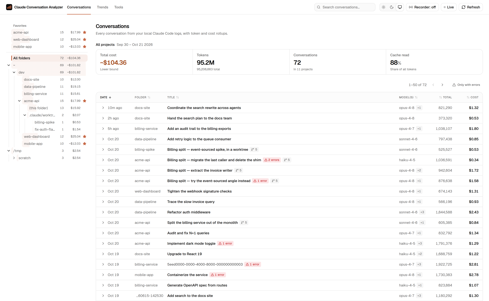
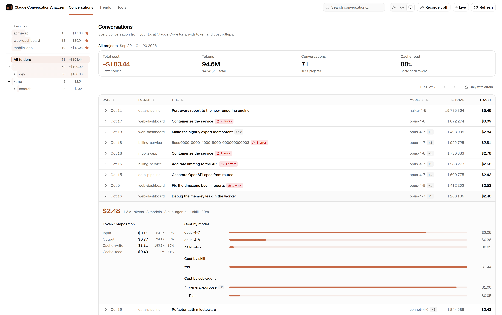
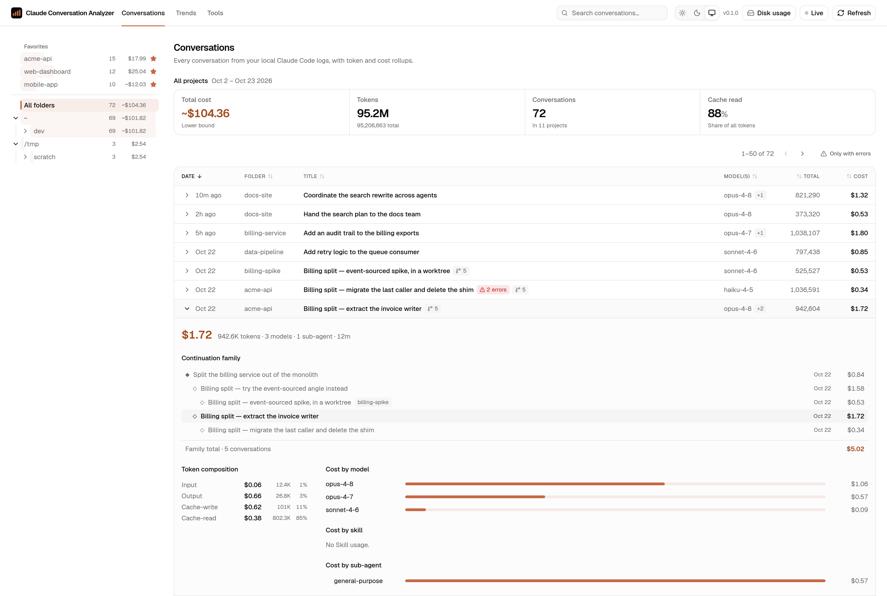
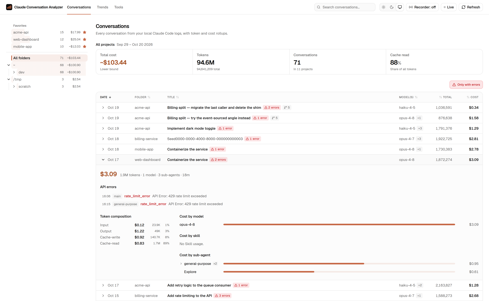
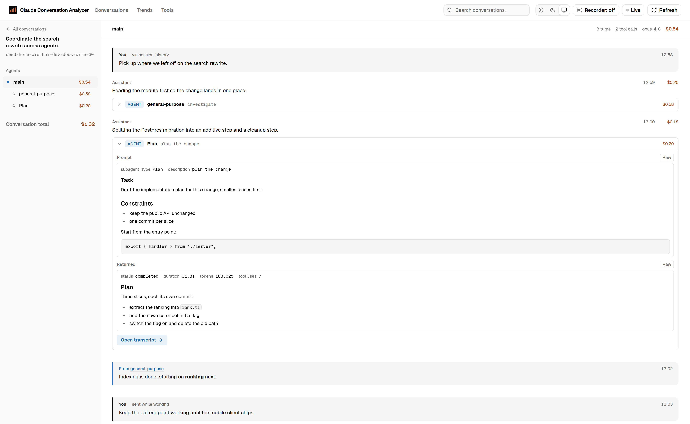
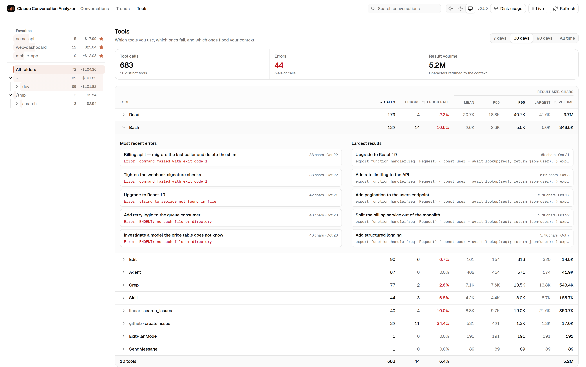
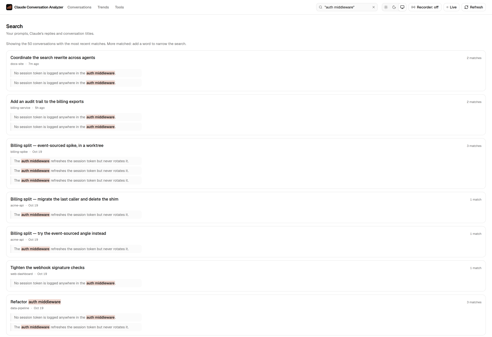

# Claude Conversation Analyzer

A local-only web app that reads the Claude Code conversation logs stored on your
machine, parses them deterministically into a SQLite database, and shows you
per-conversation token usage and cost — broken down by project, model, skill,
and sub-agent.

**Everything stays on your machine.** The app only reads `~/.claude/projects`
and writes a local SQLite file (`~/.claude-convo-analyzer/analyzer.db`); every
path is configurable. Nothing is ever sent anywhere.

> **About the cost figure:** the cost shown is always _"what these tokens would
> cost through the public API"_. If you're on a Pro or Max subscription you
> don't actually pay per token — so treat the number as the equivalent API
> value of your usage, not a bill.

## Screenshots

The conversation list — total cost, tokens, and a per-folder breakdown across
every project, sortable by any column. The folder tree in the sidebar scopes
every page to one folder and everything under it, so a repo and its git
worktrees read as one; each row's tint shows its folder's share of the total
spend, and a conversation's folder name in the list jumps to that folder. Star the folders you always want at hand — on a sidebar
row, or beside the selected folder's name above the table — and they appear
under **Favorites** at the top of the sidebar, in the order you starred them.
Drag a favorite by its grip to put it elsewhere (or press `Alt+↑`/`Alt+↓` on
the grip); the order is kept:



Expand any row for the per-model, per-skill, and per-sub-agent cost breakdown:



Work rarely fits in one sitting. When you resume a session (or fork it), Claude
Code starts a new conversation linked to the previous one — so the app groups
them into a **continuation family**: rows that belong to one show a badge with
the family size, and the expanded panel draws the whole family as a tree,
chronological and indented by fork, with each sitting's date and cost, the one
you are looking at highlighted, sittings resumed from another project labelled,
and the cumulative total of the entire piece of work at the bottom. Click any
member to jump to it. The Transcript view of a family member carries the same
lineage as a one-line banner — what it continued from, and what continues it:



When the API itself fails a turn — overloaded, rate-limited, timed out — you
usually only find out by opening the conversation. The list surfaces it instead:
any conversation with failed turns carries a badge with the count (sub-agent
failures included, since they are the conversation's failures too), and the
expanded panel lists each one — when it happened, which agent it happened in,
and what the API said — with a link straight to that turn in the Transcript. The
**Only with errors** toggle narrows the whole list to the conversations that hit
them, composing with the folder scope and the sort:



Open any conversation for the Transcript view — an IDE-like two-pane view with
the agent tree (main plus every sub-agent, each with its own cost) on the left
and one agent's turn-by-turn transcript on the right. Click a row's title to
land on the main agent, or a sub-agent in the cost breakdown to jump straight
into its transcript. Open a tool call for its full input and result; an Agent
call shows the Task prompt it gave its sub-agent and what that sub-agent handed
back, rendered as Markdown, and the sub-agent's own transcript opens on that
same Task prompt, rendered as Markdown too. A SendMessage call renders its
message as Markdown under its recipient and summary, and an ExitPlanMode call
renders its plan; "Raw" shows any call's stored JSON. A turn the model thought
on opens with a "Thinking · 1.3s" line, which unfolds the summary of that
thinking when Claude Code logged one. Your own prompts stay plain text:



"Export as HTML", under the conversation's title in the agent tree, downloads
the main thread as one self-contained `.html` file, for someone who doesn't have
the app: every message across all its pages, with its thinking, costs and every
tool call's input and stored result, rendered as the Transcript view renders
them. It needs no JavaScript and opens offline from disk; links back into the
app read as plain text. What was sent is left out, since it holds your
CLAUDE.md files, environment and system prompt. Nothing else is scrubbed yet:
paths, including your home directory, and anything a tool printed — secrets
included — stay as logged, so read the file before you share it.

The Trends page charts daily spend, stacked by model, over the last 7, 30 or 90
days or all time, for the selected folder.

The Tools page answers a different question: which tools you actually use, which
ones fail, and which ones flood your context. One row per tool — calls, error
count and rate, mean/median/p95 result size, the largest single result, and the
total volume of characters it returned — for the selected project and date
range, sub-agent calls included. Expand a row for its most recent errors and
biggest results, each linking straight to that call in the Transcript:



Search answers the "where did we discuss X?" question. The search box in the
header is on every page; it searches what was _said_ — your prompts, Claude's
replies, and conversation titles — across every project, never tool output or
machine-injected noise. Results are grouped into one card per conversation, most
recently matching first, with up to three highlighted extracts; clicking an
extract opens that conversation's transcript at the exact message, in the right
agent. Quoted phrases work too:



## Requirements

- [Node.js](https://nodejs.org) 20.9 or newer
- [pnpm](https://pnpm.io)
- Some existing Claude Code usage — the app analyzes the logs Claude Code writes
  to `~/.claude/projects`.

> **Platform support:** Tested on macOS and WSL. It has **not** been tested on
> native Windows and may not work there.

## Getting started

```bash
git clone https://github.com/flolefebvre/claude-convo-analyzer.git
cd claude-convo-analyzer
pnpm install      # also generates the Prisma client (postinstall)
pnpm build
pnpm start
```

Then open [http://localhost:3000](http://localhost:3000).

On first launch the SQLite database is created and migrated automatically — no
manual database setup — and the first Refresh, which ingests your conversation
logs, starts on its own. After that, click **Refresh** in the UI to pick up new
conversations; the parse is incremental, so subsequent refreshes only read what
changed. A Refresh runs in the background and every open page shows its
progress, so you can keep browsing while it runs. When an update changes how
logs are parsed, the next start Refreshes on its own too.

To skip the clicking, switch on **Live**, the toggle next to Refresh (off by
default). While it is on, the app watches your logs and refreshes a couple of
seconds after they change, so open pages follow your conversations as they
happen. A pulsing dot shows while it is on, and the same dot marks a
conversation as **active now**, in the list and on its transcript, while its log
changed in the last 2 minutes. The choice is saved in
`~/.claude-convo-analyzer/settings.json`, so a server restarted with Live on
starts watching again and catches up on what it missed.

The **Disk usage** item, next to Live, shows each time you open it how much
space the database and the Claude Code logs take, each with its path to copy.
The app never deletes the Claude Code logs. Recordings under
`~/.claude-convo-analyzer/recordings`, from an earlier version, are no longer
used; delete them by hand if you like.

For live development instead of a production build:

```bash
pnpm dev
```

Three environment variables move what the app reads and writes; a relative
value resolves against the process working directory (the repo root under
`pnpm`):

- `CCA_DB_PATH` — the SQLite file (default
  `~/.claude-convo-analyzer/analyzer.db`), created and migrated on first use.
  An earlier version kept it in `./data/analyzer.db`; that file is no longer
  used, so delete it by hand if you like.
- `CCA_LOGS_ROOT` — the logs root that **Refresh** scans (default
  `~/.claude/projects`).
- `CCA_SETTINGS_PATH` — the settings file that keeps whether **Live** is on
  and your **Favorites** (default `~/.claude-convo-analyzer/settings.json`).
  It sits outside the database, so a Refresh or a deleted database never loses
  them.

```bash
CCA_DB_PATH=data/demo.db CCA_LOGS_ROOT=/tmp/demo-logs pnpm dev
```

## What was sent

Since Claude Code 2.1.300 the logs record each request Claude Code sends, and
every turn of such a conversation, sub-agents included, shows **What was
sent**, in the order the model read it. One line gives the request
parameters and when it was sent. Below it, each part collapses to one line
and opens for detail: the system prompt, flagged when it changed since the
previous request (a change of only the date, git status or working directory
reads as volatile) with its diff one toggle away; the tools, with those added,
removed or changed; how many earlier messages it repeated; and, under **New
for this Turn**, each block the request added, labelled — the prompt, a tool
result, the context Claude Code injected, each piece of it named for what it is
(the CLAUDE.md and AGENTS.md files, Skill list, Date, Environment, Token
budget, …) and a message fusing several split into one line each, opening to
its text exactly as sent. **Raw JSON** swaps the view for the
request body as the logs rebuild it, as copyable JSON. A message the logs
cannot rebuild is shown missing and counted. A turn Claude Code had to retry
shows how many failed attempts preceded it and the time they lost, though not
why they failed. Conversations logged by earlier versions of Claude Code show
none of this.

Claude Code's own background requests (naming the session, suggestions, web
summaries) never appear in the logs, so no cost counts them.

## How it works

The app discovers each **project** (a directory where you ran Claude Code) under
`~/.claude/projects`, parses every session's `.jsonl` transcript, and stores a
deterministic, deduplicated token ledger. Cost is computed in application code
from a per-model, per-token-type price list — it's a hypothetical "what these
tokens would list for on the public API today" figure, not your actual billing.

The domain model and the reasoning behind it are documented in
[`GLOSSARY.md`](GLOSSARY.md) and the ADRs under [`docs/adr/`](docs/adr).

## Roadmap

Today the app answers _"where did the tokens and cost go?"_. The next steps push
it toward _"what actually happened in these conversations, and how do I make them
better?"_

- **Usage stats by skill and sub-agent.** The Tools page already covers tool
  usage (calls, errors, result sizes). The same behavioural lens still has to
  reach skills and sub-agents — how often each skill fires, how sub-agents are
  distributed across a run — so you see your real usage patterns, not just the
  bill.

- **Deeper conversation analysis — surfacing friction.** When running fully
  autonomous, different sub-agents often grind on the _same_ underlying problem —
  e.g. a missing piece of context like how to invoke a command. The goal is to
  detect these recurring friction points automatically and make them visible, so
  a single fix (a note in `CLAUDE.md`, a better tool description) can unblock
  every future run instead of each agent rediscovering the wall.

Have an idea or a friction pattern you'd like surfaced? Open an issue.

## Development

The validation gate — format check, lint, duplication and typecheck in
parallel, then test and build in parallel, then the Playwright end-to-end specs;
it passed only if the output ends with `--gate OK--`. `pnpm check` is the faster
inner loop: the same static checks, then only the tests affected since
`origin/main` (`--check OK--`):

```bash
pnpm check
pnpm gate
```

The end-to-end specs need Chromium, installed once with
`pnpm exec playwright install chromium`.

See [`docs/codebase/testing.md`](docs/codebase/testing.md) for the testing
approach and fixtures.

For demo data, `pnpm seed` builds a self-contained seed environment in
`data/seed/`: invented logs in `data/seed/projects/`, ingested into
`data/seed/seed.db`. Each run wipes and rebuilds that directory; your real
database and logs are never read or written. To seed and serve the app on it in
one step:

```bash
pnpm dev:seed
```

It prints `Seeded app: http://localhost:<port>` — the first free port from
3001, or `PORT` when set — so several checkouts can each run their own. Refresh
in that app re-reads only the seeded logs, and `CCA_SETTINGS_PATH` points at
`data/seed/settings.json`, so
Live starts off with three seeded favorites, and your own settings are never
touched.

The seeded activity ends now. `pnpm seed` also takes `--now=<ISO>`, and the same
`--now` always yields the same data, which is what screenshots want; point the
app at that seed with the two variables above:

```bash
pnpm seed --now=2026-06-22T17:00:00Z
CCA_DB_PATH=data/seed/seed.db CCA_LOGS_ROOT=data/seed/projects pnpm dev
```

## Was this made with AI?

Yes.

## How to contribute

Found a bug or have an idea? Open an issue.

## License

[MIT](LICENSE)
